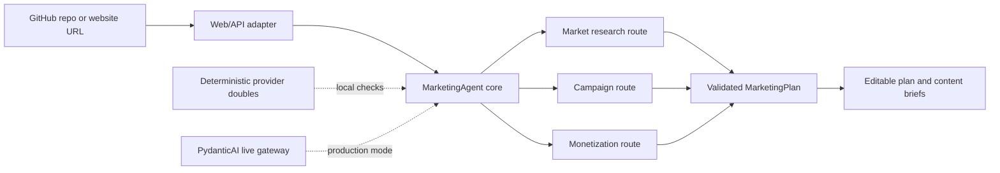

# ContentAgent

ContentAgent is a local Marketing Agent application. It accepts a software source, either a GitHub repository URL or a website URL, and generates a monetization-focused marketing plan with market research, campaign orchestration, monetization experiment recommendations, editable plan text, and content briefs.

The backend now has a PydanticAI-only live model gateway for production provider calls. Local development still runs without network access by using deterministic provider doubles through that same gateway, so routing, validation, retry, fallback, scoring, and ranking behavior can be tested without API keys.

## System Flow



## Requirements

- Python 3.10 or newer
- A shell that can run the repository scripts
- Optional for live model routing: `pydantic-ai` plus OpenAI and Gemini API credentials

The default local app uses only the Python standard library. Live provider mode imports PydanticAI lazily only when enabled.

## API Keys And Live Routing

Production model behavior must use PydanticAI only. LangGraph is not used.

To enable live OpenAI/Gemini routing:

```bash
export CONTENT_AGENT_LIVE_MODELS=1
export OPENAI_API_KEY="your-openai-api-key"
export GEMINI_API_KEY="your-gemini-api-key"
```

Optional model overrides:

```bash
export CONTENT_AGENT_OPENAI_MODEL="openai:gpt-4o-mini"
export CONTENT_AGENT_GEMINI_MODEL="google-gla:gemini-1.5-flash"
```

Do not commit `.env` files, real keys, or provider logs containing secrets.

## Capabilities

- Routes each major task type through a `LiveModelRoute`.
- Supports OpenAI/Gemini fallback chains through the PydanticAI Model Gateway.
- Enforces finite retry budgets per provider.
- Validates every stage artifact before downstream stages consume it.
- Records provider attempts on the returned `MarketingPlan`.
- Generates campaign and offer variants.
- Scores recommendations by conversion potential, CAC risk, and channel fit.
- Returns ranked monetization recommendations before content generation.

## Run Locally

From the repository root:

```bash
python3 -m web_app.server
```

Then open:

```text
http://127.0.0.1:8000
```

The app serves the Web Interface and exposes the API endpoint:

```text
POST /api/marketing-plan
```

Example API request:

```bash
curl -s http://127.0.0.1:8000/api/marketing-plan \
  -H "Content-Type: application/json" \
  -d '{
    "software_source": "https://github.com/acme/revenue-dashboard",
    "user_interventions": [
      {
        "stage_name": "Market Research",
        "feedback": "Prioritize finance teams with budget authority."
      }
    ]
  }'
```

## Run Checks

Run the full deterministic gate:

```bash
./scripts/check.sh
```

Run only the Python behavior tests:

```bash
PYTHONDONTWRITEBYTECODE=1 python3 -m unittest discover -s tests -p 'test_*.py'
```

## Project Structure

- `src/marketing_agent/__init__.py`: Marketing Agent bounded context, PydanticAI gateway, routing controls, experiment engine, and public Python interface.
- `web_app/server.py`: thin HTTP adapter for the Web Interface.
- `web/static/`: browser UI assets.
- `tests/`: behavior tests for the core agent and web adapter.
- `agent/`: design, architecture, testing, and ADR documentation.

## Provider Behavior

`MarketingAgent()` defaults to deterministic provider doubles for local checks. Set `CONTENT_AGENT_LIVE_MODELS=1` to use the live PydanticAI provider client. In both modes, the Marketing Agent uses the same route table, validation, retry budget, fallback, and artifact acceptance logic.
